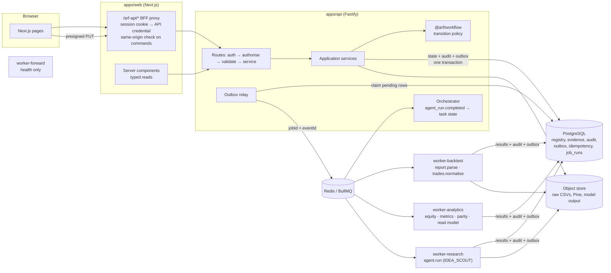

# Architecture (vertical slice)

This document describes what is implemented in the first vertical slice. The
full target architecture is in `AI_RESEARCH_HEDGE_FUND_SPEC.md`.

## Processes

## Evidence pipeline

Every step is a BullMQ job whose id is derived from the triggering event id,
and every job writes its results, an audit record and its follow-up outbox
event in one transaction. Workers never change lifecycle state; the API and
the orchestrator do, through `@arf/workflow`.

| Event | Job (queue) | Output |
|---|---|---|
| `report_upload.completed` | `report.parse` (backtest) | parsed report artefact, parser warnings, upload status |
| `verification.reports_parsed` | `trades.normalise` (backtest) | `backtest_runs`, `trades`, TradingView-reported metric snapshots |
| `trades.normalised` | `equity.reconstruct` (analytics) | `equity_points`, `drawdown_points` |
| `equity.reconstructed` | `metrics.calculate` (analytics) | ARF-calculated `metric_snapshots` |
| `metrics.calculated` | `parity.calculate` (analytics) | `parity_reports`; verification `COMPLETED` |
| `parity.calculated` | `read_model.refresh` (analytics) | `strategy_library_rm` row |
| `agent_run.requested` | `agent.run` (research) | idea card, handoff, protected raw output |
| `agent_run.completed` | orchestrator (API process) | task `IDEA_RESEARCH → HYPOTHESIS_DRAFT` or `BLOCKED` |

Job progress is persisted in `job_runs` (status, attempts, last error code) and
streamed to the verification page over SSE. Terminal errors (bad input that a
retry cannot fix) are marked `FAILED_TERMINAL` and not retried.

## Trust boundaries

- **Browser → web.** The browser holds only an HTTP-only session cookie. The
  BFF exchanges it for the API credential, forwards only `/v1/*` paths and
  rejects cross-site commands.
- **Web → API.** Every request is authenticated; the organisation header is a
  hint that is checked against membership, never trusted. Every query is
  scoped by the caller's organisation.
- **API → workers.** Workers re-validate job payloads with Zod and re-load
  aggregates by organisation id.
- **Model output.** Raw provider output is stored as a `PROTECTED` artefact;
  only validated structured output reaches normal records, and it is rendered
  as plain text.
- **TradingView exports.** Parsed deterministically; never sent to a model.

## Packages

| Package | Responsibility |
|---|---|
| `@arf/contracts` | Zod schemas, branded ids, examples, JSON Schema export |
| `@arf/db` | Drizzle schema, migrations, audit chain, outbox, read models, seed |
| `@arf/auth` | Dev and Clerk verifiers, roles and permissions, separation-of-duties helper |
| `@arf/workflow` | Transition table, evidence requirements, policy version |
| `@arf/pine` | Pine lint, approved template, hashing, TradingView CSV adapters |
| `@arf/metrics` | Equity, drawdown, metrics and parity as pure decimal functions |
| `@arf/storage` | Object-store interface, S3 driver, local HMAC driver |
| `@arf/event-bus` | Queues, routing, idempotent publish, tracked jobs |
| `@arf/agent-runtime` | Provider interface, structured runner with one repair retry, fixture provider |
| `@arf/backtest-sdk` | Runner interface and capability matrix (no local runner yet) |
| `@arf/observability` | Structured logging, metrics instruments, health server |
| `@arf/ui` | Evidence labels, state badges, empty/error/stale states, decimal formatting |
